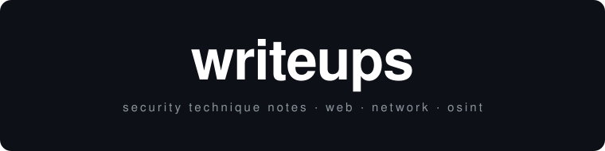

**EN** — Security technique notes: how I approach the vulnerability classes I
work with, with the methodology and payloads I actually use. These explain
*techniques*, on my own examples — no challenge solutions, no spoilers.

**FR** — Notes de technique sécurité : ma façon d'aborder les classes de
vulnérabilités sur lesquelles je travaille, avec la méthodo et les payloads que
j'utilise vraiment. Ça explique des *techniques*, sur mes propres exemples —
aucune solution de challenge, aucun spoiler.

## Writeups

**Web**
- SQL injection — [EN](en/web/sql-injection.md) · [FR](fr/web/sql-injection.md)

More coming / À venir : LFI, JWT, ARP spoofing / MITM…

---

Built by **White** · [github.com/white-exee](https://github.com/white-exee)
